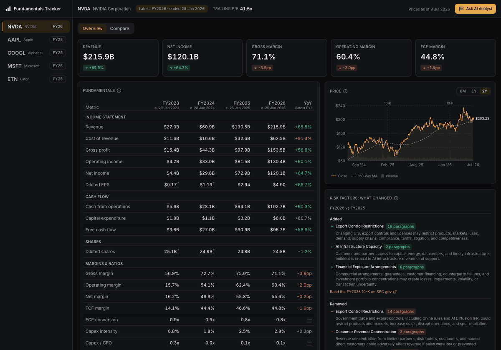
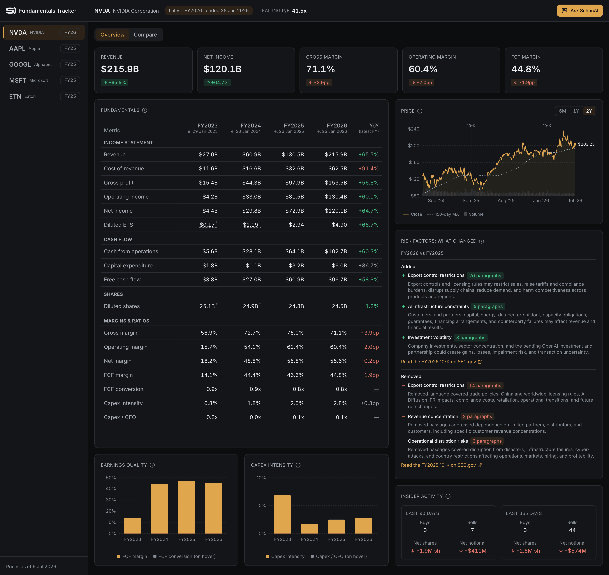
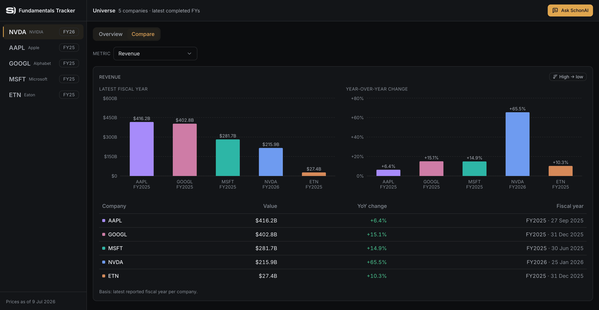
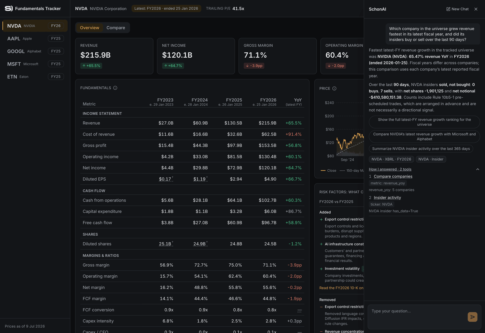
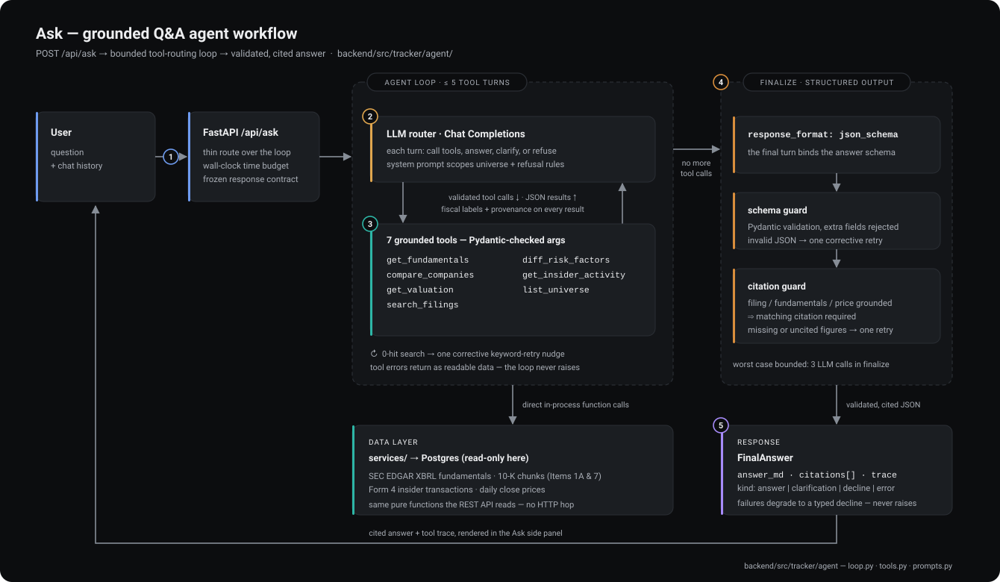

<p align="center">
  <picture>
    <source media="(prefers-color-scheme: dark)" srcset="docs/img/schonfeld-logo-light-ink.png">
    
  </picture>
</p>

<h1 align="center">Fundamentals Tracker</h1>

<p align="center">
  SEC-filing fundamentals and market data for a configurable equity universe,<br>
  served through an analyst dashboard and a grounded LLM Q&amp;A layer.
</p>

<p align="center">
  <a href="https://github.com/AmirDehkordi/Dehkordi_Amir_QuantDev_CaseStudy/actions/workflows/ci.yml"></a>
  <a href="https://codecov.io/gh/AmirDehkordi/Dehkordi_Amir_QuantDev_CaseStudy"></a>
</p>

<p align="center">
  
</p>

---

The tracker ingests three sources for a five-company universe (NVDA, MSFT, AAPL, GOOGL, ETN —
configurable by environment variable): XBRL fundamentals from SEC EDGAR, 10-K narrative and Form 4
insider filings, and daily market prices. Every user-facing number carries a fiscal-year label and
filing provenance, restatements are surfaced rather than overwritten, and the Q&A agent answers only
from deterministic tool results — with citations, or not at all.

**At a glance:**

- **One command to a working product.** `docker compose up` on a fresh clone serves a fully
  populated dashboard from the committed seed; no keys, no live API calls.
- **Grounded by construction.** The agent's 7 tools call the same typed service functions as the
  REST API. The LLM routes and narrates; it never computes a number.
- **15/15 on the eval suite**, including the brief's six questions verbatim, machine-checked for
  routing, citations, refusals, and fiscal labeling.
- **Fiscal discipline throughout.** Values render as "FY2025 (ended 27 Sep 2025)", restatements
  keep the superseded value, and every row traces to its accession number.

## The dashboard

**Overview** — per-company fundamentals with fiscal labels, restatement markers, and per-metric
polarity on year-over-year deltas; price with a 150-day moving average and volume; insider activity;
and risk-factor changes between the two most recent 10-Ks:



**Compare** — one metric across the universe, each company on its latest reported fiscal year, with
the year-over-year change alongside:



**Ask** — natural-language Q&A in a side panel, grounded in the same service layer the charts read.
Every answer ships with source citations and the full tool trace:



## Quickstart

```bash
cp .env.example .env    # set LLM_BASE_URL / LLM_API_KEY / LLM_MODEL — see Configuration
docker compose up
```

then visit http://localhost:8000.

A cold clone serves a fully populated dashboard from the committed seed alone; nothing calls EDGAR or
Yahoo at startup. Only `/api/ask` needs a working LLM endpoint. To try it from the command line:

```bash
curl -s -X POST http://localhost:8000/api/ask \
  -H 'Content-Type: application/json' \
  -d '{"question": "What is AAPL'\''s trailing P/E right now?", "history": []}' | python3 -m json.tool
```

## Configuration

| Variable | Required | Purpose |
|----------|----------|---------|
| `DATABASE_URL` | yes | Postgres connection string (psycopg 3 driver) |
| `LLM_BASE_URL` | yes | OpenAI-compatible endpoint the agent calls (Chat Completions surface) |
| `LLM_API_KEY` | yes | API key for that endpoint |
| `LLM_MODEL` | yes | Model id to request |
| `SEC_USER_AGENT` | yes | `"Name email (purpose)"` — SEC requires a declared UA on every EDGAR request |
| `UNIVERSE` | no | Comma-separated tickers; defaults to `NVDA,MSFT,AAPL,GOOGL,ETN` |

Pointing the agent at a different provider — including Schonfeld's proxy at review time — is a
configuration change, not a code change: set `LLM_BASE_URL`, `LLM_API_KEY`, and `LLM_MODEL` in `.env`
for `make run`, or as environment overrides for `docker compose up`. The agent speaks plain Chat
Completions to whatever `base_url` it is given (`backend/src/tracker/agent/llm.py`), the interface
every proxy and alternative provider implements.

## Model

The pinned model is **`gpt-5.5`**, the current GA flagship reasoning model, requested over the
standard Chat Completions surface. Against the eval suite below it scores **15/15**, including all
six questions from the brief ([evals/last_run.md](evals/last_run.md)).

Because a review-time proxy's capabilities cannot be assumed, structured output leans on the most
portable request shape rather than provider features: the final answer is requested as
`response_format: json_schema` with `strict: false`, and the real guard is local — the reply is
validated against the Pydantic answer schema, retried once with a corrective message on a
validation failure, and degraded to a typed error answer (never a 500) if that also fails
(`backend/src/tracker/agent/loop.py`). Swapping providers means editing three environment
variables and nothing else: model, key, and base URL reach the client only from the environment,
verified at the wire level (a bogus `LLM_MODEL` value surfaces verbatim in the provider's 404).
No second provider has been exercised end-to-end against the eval suite.

## Architecture

```
  SEC EDGAR (XBRL, filings, Form 4)        Yahoo Finance (prices, stooq fallback)
                    │                                     │
                    └─────────────────┬───────────────────┘
                                      ▼
                      ingestion/   only outbound HTTP; bronze-caches every
                                   raw response; --from-cache replays offline
                                      │
                                      ▼
                      PostgreSQL 16  committed pg_dump (seed/init/) restores
                                     on first boot — cold clone, zero live calls
                                      │
                                      ▼
                      services/    pure, typed; no HTTP, no LLM
                         │                              │
                         ▼                              ▼
               api/ (FastAPI)               agent/ (openai SDK tool loop,
               GET /api/… — frozen           7 tools over the same services)
               contracts                          │ POST /api/ask
                         │                        │
                         └───────────┬────────────┘
                                     ▼
               frontend/  React 18 + Vite + TS, built to static files,
                          served by FastAPI in the packaged container
```

One rule shapes the codebase: numbers are computed exactly once. `services/` holds the pure, typed
functions that read the database; the REST API and the agent's tools are both thin callers of those
functions, so a value plotted in a chart and a value cited in an answer share a code path by
construction. The LLM routes questions and narrates results; it never touches HTTP, SQL, or
arithmetic.

The Ask pipeline in detail — a bounded tool-routing loop (at most 5 tool turns) over 7 grounded
tools, followed by a structured finalize pass that enforces schema validity and citation coverage.
Every failure mode degrades to a typed decline, never an exception:



The full design writeup — fiscal-alignment rules, the cross-source trailing-P/E join, restatement
handling, and the deliberate cuts — is in **[docs/DESIGN.md](docs/DESIGN.md)**. It is paired with
**[PLAN.md](PLAN.md)**, the AI planning document that preceded the build, with the committed
[.claude/](.claude/) skills, agents, and commands as the working instructions used during
development.

## Q&A evaluation

The eval suite (`evals/questions.yaml`) puts 15 natural-language questions to a live `/api/ask`.
Q1–Q6 are the six questions from the case-study brief, verbatim
([evals/questions.yaml, lines 16–57](evals/questions.yaml#L16-L57)); Q7–Q15 add rewordings,
out-of-universe and forward-looking traps, an ambiguity case, and coverage for the custom metrics.

**From the brief:**

- **Q1.** What were NVDA's revenue and net income for the last three fiscal years?
- **Q2.** Which of the five companies had the highest gross margin last year?
- **Q3.** What is AAPL's trailing P/E right now?
- **Q4.** What new risk factors did NVDA add in its latest 10-K versus the prior year?
- **Q5.** How did MSFT's revenue grow last year, and what did management attribute it to?
- **Q6.** What is the company's forward guidance for next quarter?

**Added coverage:**

- **Q7.** Across the tracked companies, whose gross margin was widest in its most recent fiscal year?
- **Q8.** What is NVDA's trailing price-to-earnings ratio at the moment?
- **Q9.** What has MSFT insider buying and selling looked like recently?
- **Q10.** How did AAPL's risk factor disclosures change between its two most recent 10-K filings?
- **Q11.** What is Tesla's margin?
- **Q12.** Where will AAPL revenue be next year?
- **Q13.** What are the main themes in NVDA's MD&A?
- **Q14.** what's the most risk metric? *(deliberately malformed — ambiguity/clarification case)*
- **Q15.** How capital intensive is MSFT compared to AAPL?

For each question, `evals/run.py` machine-checks routing (which tools were called), refusal
behavior, citation completeness, fiscal-year labeling, and answer content, then writes the results
to [evals/last_run.md](evals/last_run.md). Reproduce with `make evals`.

**Latest run — `gpt-5.5`, 15 questions posted sequentially (a configurable `EVALS_DELAY_S` pause
between calls keeps a provider's tokens-per-minute limits out of the results):**

| Metric | Value |
|---|---|
| Pass rate | 15/15 (100%) — brief 6/6 |
| Latency | avg 17.6s · median 16.0s · range 6.4–35.3s |
| Tokens per question | avg 7,033 · range 3,893–10,865 |
| Total tokens | 105,488 |

| ID | Category | Tools called | Result | Latency | Tokens |
|---|---|---|---|---|---|
| Q1 | structured | `get_fundamentals` | PASS | 16.0s | 7,818 |
| Q2 | comparative | `compare_companies` | PASS | 11.5s | 7,237 |
| Q3 | valuation | `get_valuation` | PASS | 6.4s | 6,688 |
| Q4 | filing text | `diff_risk_factors` | PASS | 24.9s | 10,125 |
| Q5 | cross-modal | `get_fundamentals`, `search_filings` | PASS | 35.3s | 10,865 |
| Q6 | out-of-scope decline | — | PASS | 6.5s | 3,972 |
| Q7 | comparative, reworded | `compare_companies` | PASS | 10.6s | 7,307 |
| Q8 | valuation, reworded | `get_valuation` | PASS | 23.1s | 6,666 |
| Q9 | insider activity | `get_insider_activity` | PASS | 11.4s | 6,900 |
| Q10 | filing text, reworded | `diff_risk_factors` | PASS | 22.3s | 9,892 |
| Q11 | out-of-universe decline | — | PASS | 24.0s | 4,065 |
| Q12 | forward-looking decline | — | PASS | 12.3s | 3,893 |
| Q13 | filing text | `search_filings` | PASS | 27.9s | 8,562 |
| Q14 | clarification | — | PASS | 11.7s | 3,970 |
| Q15 | comparative, own metric | `compare_companies` | PASS | 20.2s | 7,528 |

Each row also asserts citation completeness — every stated figure must trace to a `fundamental`,
`price`, `filing`, or `insider` source — and, where applicable, fiscal-year labeling in the answer
text. The per-case assertion semantics live in `evals/run.py`, and the fixes that hardened the
agent loop before submission are documented in
[docs/DESIGN.md](docs/DESIGN.md#notes-from-the-pre-submission-audit).

## Repository layout

```
backend/src/tracker/   config · db · ingestion · services · agent · api
frontend/              React 18 + Vite + TypeScript dashboard
evals/                 question set, runner, committed evidence (last_run.md)
seed/                  committed pg_dump + bronze-cached raw source responses
docs/                  design writeup, build sequence, screenshots
```

## Make targets

| Target | Purpose |
|--------|---------|
| `make setup` | Install backend deps into the uv-managed venv |
| `make web-setup` | Install frontend deps (Node 20) |
| `make db-up` / `make db-down` | Start/stop the Postgres dev database |
| `make init-db` | Create all tables against `DATABASE_URL` (idempotent) |
| `make run` | Serve the API with reload |
| `make test` / `make test-all` | Unit tests only / full suite incl. integration (needs Postgres) |
| `make verify` | Format + lint + types + coverage gates, then the frontend gate |
| `make evals` | Run the eval suite against a running `/api/ask` (needs a live LLM key) |
| `make cache-risk-themes` | Precompute + cache Item 1A risk themes for the tracked universe |
| `make seed-dump` | Dump the dev DB to `seed/init/` (restored on a fresh clone) |
| `make fresh-check` | Fresh-clone rehearsal: clone, `docker compose up`, `/health`, `/api/companies`, one `/api/ask` |
