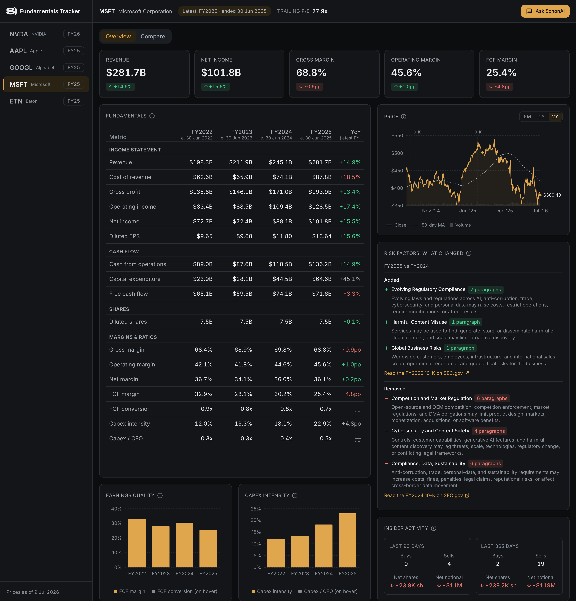

# Fundamentals Tracker

A dashboard tracking SEC-filing fundamentals + market data for a small configurable universe, with a
grounded LLM Q&A layer.

## Screenshots

Overview — per-company fundamentals (fiscal labels, restatements, and a per-metric polarity map on
deltas), a price trend with a 150-day moving average + volume sub-panel, insider activity, and
risk-factor changes:

Compare — one metric across the universe on each company's latest reported fiscal year (left) and its
year-over-year change (right), sorted high-to-low:

Ask — grounded natural-language Q&A with source citations and a tool trace, in a non-modal side panel:

## Quickstart

_Lands in P10 (packaging)._

## Environment

_Lands in P10 (packaging)._

## Models

_Lands in P10 (packaging)._

## Examples

_Lands in P10 (packaging)._

## Architecture

_Lands in P10 (packaging)._
