# Build sequence

Dependency order of the ten build chunks across the six lanes (see PLAN §10) — **sequence, not
durations**. P1 is complete; the ingestion, backend and frontend lanes then run in parallel, the agent
and UI converge, and packaging is last.

Assets in this folder:

- [`build-sequence.html`](build-sequence.html) — self-contained interactive viewer (open in a browser).
- [`build-sequence.png`](build-sequence.png) — static image for slides / Word / PDF write-ups.
- The Mermaid diagram below renders inline on GitHub and in VS Code (Mermaid preview).

## Diagram

```mermaid
gantt
    title Fundamentals Tracker — build sequence (dependencies, not time)
    dateFormat  X
    axisFormat  %s
    section Foundation
      P1 Foundation                    :done, p1, 0, 1
    section Ingestion
      P2 XBRL ingestion                :p2, after p1, 1
      P3 Narratives/Form4/prices/seed  :p3, after p2, 1
    section Backend
      P4 Metrics engine (services)     :crit, p4, after p1, 1
      P5 API endpoints + freshness     :crit, p5, after p4, 1
    section Frontend
      P6 Frontend foundation           :p6, after p1, 1
      P7 Data panels + Compare         :crit, p7, after p5 p6, 1
    section Agent
      P8 Agent (tools, loop, /api/ask) :p8, after p4 p3, 1
    section Q&A + Evals
      P9 Q&A UI + evals                :crit, p9, after p7 p8, 1
    section Packaging
      P10 Packaging + fresh-clone      :crit, p10, after p9, 1
```

## Dependencies

| Chunk | Needs | Why |
|-------|-------|-----|
| P1 Foundation | — | base |
| P2 XBRL ingestion | P1 | schema + shared EDGAR client rails |
| P3 Narratives / Form 4 / prices / **seed** | P2 | reuses the shared client; the pg_dump seed needs P2's data |
| P4 Metrics engine | P1 | services read the frozen schema; unit-tested on the `mini_seed` fixture |
| P5 API endpoints | P4 | routers are thin over services |
| P6 Frontend foundation | P1 | types from the frozen OpenAPI + the working `/api/companies` |
| P7 Data panels + Compare | **P5 + P6** | panels need the endpoints *and* the shell |
| P8 Agent | **P4 + P3** | tools call the services (P4); retrieval / risk-diff / insider need P3's data |
| P9 Q&A UI + evals | **P7 + P8** | the Q&A sheet lives in the frontend; evals hit the agent |
| P10 Packaging | P9 | everything assembled → fresh-clone rehearsal |

**Critical path:** `P1 → P4 → P5 → P7 → P9 → P10` — the longest chain, so it sets the wall-clock floor.
The ingestion lane (`P2 → P3`) and P6 have slack and feed in along the way. The parallelizable starting
trio is **P2 · P4 · P6** (stage 1).
